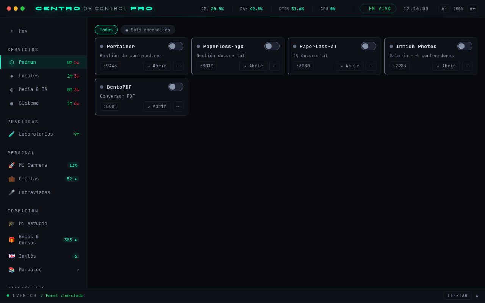
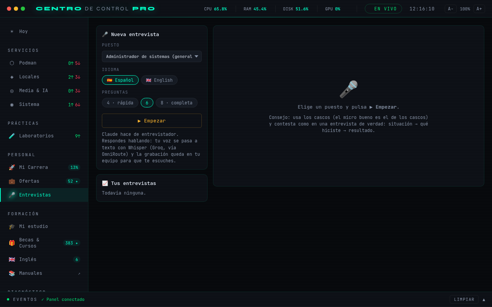
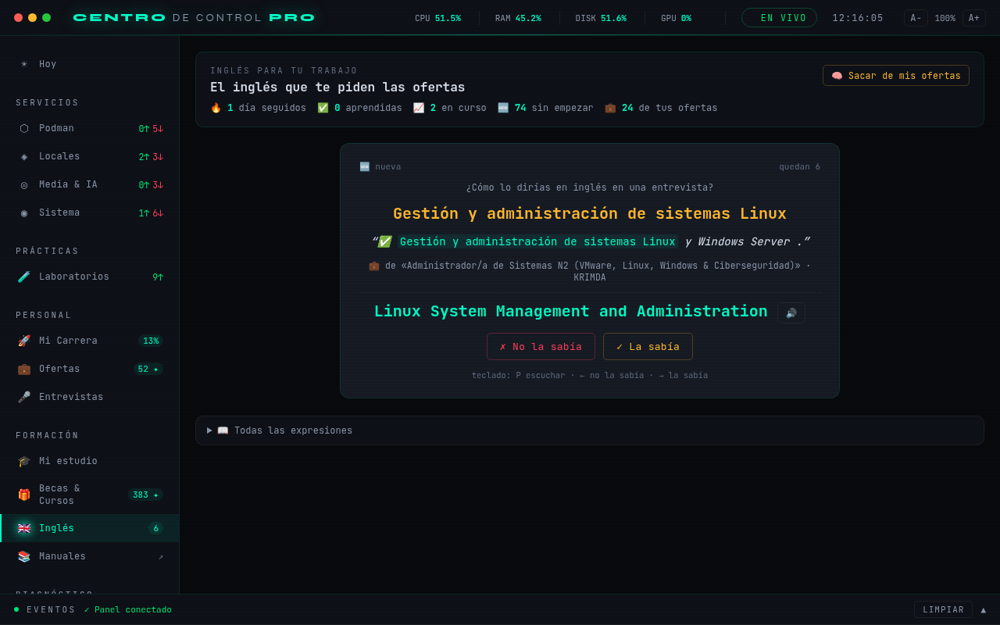
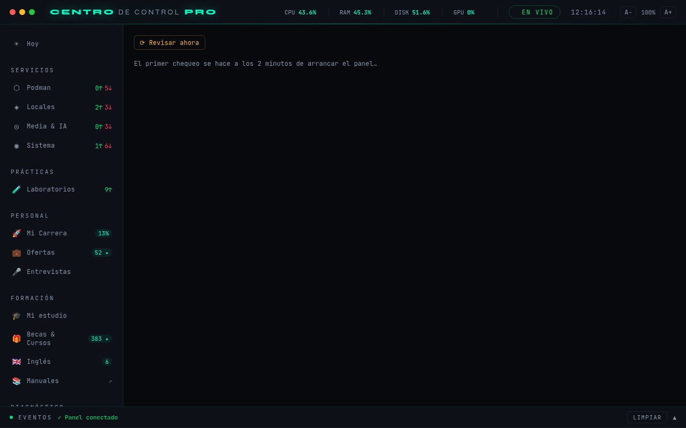
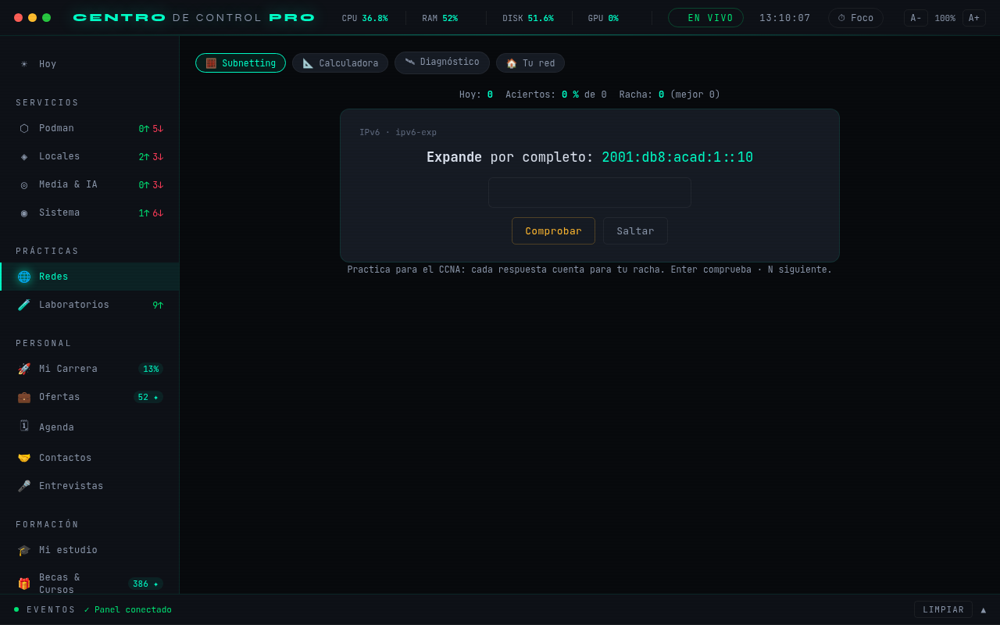

# Centro de Control PRO

**Panel de control personal para un homelab Linux, con búsqueda de empleo, estudio de certificaciones y entrenamiento de entrevistas, todo asistido por IA local.**

*A self-hosted desktop control panel (Python · Flask · Socket.IO · PyWebView/GTK) that runs my Podman homelab and doubles as a career toolkit: job-board scraping with source-health checks, local-LLM evaluation of job offers, an anti-hallucination reviewer for AI-generated CV text, a voice-driven mock interviewer (Piper TTS + Whisper), spaced-repetition English built from real job ads, VM/lab orchestration (VMware, KVM, Cisco CML) and automated system maintenance. Spanish UI.*



---

## Qué hace

| Área | Funciones |
|---|---|
| **Homelab** | 20 servicios (Podman, procesos y módulos del kernel) con encendido/apagado, healthchecks, uptime, actualización de imágenes y notificaciones de escritorio. |
| **Laboratorios** | VMs de VMware Workstation (`vmrun`) y KVM/libvirt (`virsh`), Cisco Modeling Labs y detección de contenedores de práctica olvidados, con aviso de RAM antes de encender. |
| **Mantenimiento** | 14 chequeos automáticos cada 6 h: discos, logs desbocados, journal, GPU visible para la IA (CDI de NVIDIA), reinicio pendiente por kernel nuevo, Tailscale, espacio de Podman, copias de seguridad… con arreglos de un clic en lista blanca. |
| **Empleo** | Lectores de InfoJobs, Tecnoempleo y LinkedIn, evaluación de cada oferta con un LLM local, registro de candidaturas con seguimiento y aviso cuando un portal deja de devolver resultados (o pide captcha). |
| **Candidaturas** | Perfil de CV, carta y preguntas de entrevista adaptados a cada oferta, con un **revisor anti-invenciones**: segunda pasada del modelo y reglas que detectan empresas cambiadas, certificaciones inventadas o cifras que no están en el CV. |
| **Entrevistas** | Simulador por voz: el modelo hace de entrevistador (español o inglés), tú respondes hablando y recibes un informe con nota, mejoras y correcciones de inglés. |
| **Inglés** | Vocabulario extraído de las ofertas reales, repaso espaciado (Leitner) y pronunciación con voz neuronal local. |
| **Estudio** | Mapa de mis plataformas de estudio (LPIC, CCNA, AZ-104…) con progreso real leído en solo lectura, **reto de laboratorio del día** elegido entre 233 labs según lo que más fallo, y **tarjetas de repaso a partir de una captura** (modelo con visión). |
| **Redes** | Entrenador de subnetting IPv4/IPv6 para el CCNA, calculadora de subredes, ping/mtr/traceroute/DNS con validación estricta del destino, puertos en escucha y **vigilante de la red local** (dispositivos nuevos por ARP/nmap, latencia y velocidad). |
| **IA en segundo plano** | Cola de trabajos para el modelo local que solo corre **enchufado, sin videollamada (cámara o micro en uso) y con la GPU libre**: tras cada búsqueda evalúa las mejores ofertas, filtra los cursos y becas nuevos (sirve / dudosa / descartada) y saca el vocabulario en inglés. Enciende Ollama para la tanda y lo apaga al acabar. |
| **Organización** | Agenda con avisos y exportación `.ics`, contactos de la búsqueda de empleo con borradores de mensaje, comparador de sueldo neto (IRPF + Seguridad Social), modo foco con horas por materia y **resumen semanal** con mensaje de un coach. |

| | |
|---|---|
|  |  |
|  |  |

---

## Cómo está hecho

```
PyWebView (GTK/WebKit2)  ←→  Flask + Flask-SocketIO (127.0.0.1)  ←→  Podman · vmrun · virsh · systemd
        │                         │
        │                         ├── Ollama (LLM local, GPU)       → evaluar ofertas, filtrar becas, extraer vocabulario (cola_ia)
        │                         ├── OmniRoute (router de LLMs)    → candidaturas y entrevistas, Whisper
        │                         └── Piper (TTS local)             → voz del entrevistador y pronunciación
        └── UI en HTML/CSS/JS sin framework, una pieza por pestaña (ui/partials, ui/static/js)
```

- **Backend:** Python 3.13, Flask, Flask-SocketIO (eventos en tiempo real), hilos en segundo plano para monitores y tareas largas.
- **Escritorio:** PyWebView con backend GTK (≈500 MB de RAM frente a 14 GB con QtWebEngine), icono en la bandeja con pystray.
- **IA:** Ollama local (qwen3.5:4b, cabe entero en los 4 GB de la GPU) para lo privado; un router compatible con OpenAI para los modelos grandes y Whisper; Piper para TTS.
- **Datos:** JSON por módulo con escritura atómica (`.tmp` + `os.replace`); copia diaria comprimida con 30 días de historia.

### Decisiones que me importan

- **Seguridad de una API local.** Un servidor en `127.0.0.1` no está a salvo del navegador: cualquier web podía enviarle `POST` *simple requests* sin preflight, y con DNS rebinding leer ficheros. El panel valida `Host` y `Origin` en cada petición, el socket solo acepta su propio origen, y todo lo que ejecuta comandos (VMs, contenedores, acciones de mantenimiento) acepta solo identificadores de una lista que él mismo ha generado. Hay pruebas para cada caso.
- **La IA no puede inventar experiencia.** Los textos para candidaturas pasan por un revisor: una tabla de qué se hizo en cada empresa (que también va en el prompt), reglas de bajo ruido y una segunda pasada del modelo que señala cada frase no respaldada por el CV.
- **Aprovechar la GPU sin estorbar.** El trabajo de IA que no corre prisa va a una cola que espera a que el portátil esté enchufado, sin llamada y con VRAM libre, y se para entre un trabajo y otro si empieza una videollamada. Las respuestas del modelo se leen con un parser tolerante: aunque se pida `format: json`, qwen3.5 a veces lo envuelve en un bloque de código.
- **Lectores frágiles, fallos visibles.** Los portales cambian su HTML sin avisar: cada búsqueda registra cuántos resultados trae cada fuente y el panel avisa cuando una lleva dos búsquedas a cero, distinguiendo un captcha de un lector roto.
- **Nada personal en el código.** Perfil, plan de carrera y rutas del equipo viven en `perfil.json` y `.env`, fuera de git; el repositorio trae ejemplos ficticios.

---

## Puesta en marcha

```bash
git clone <este repositorio> && cd MiPanelControl
# Debian/Ubuntu: WebKit2GTK y PyGObject para la ventana nativa (no van por pip)
sudo apt install python3-gi python3-gi-cairo gir1.2-webkit2-4.1
python3 -m venv venv && venv/bin/pip install -r requirements.lock   # versiones exactas probadas
echo "/usr/lib/python3/dist-packages" > venv/lib/python3.*/site-packages/_system_gi.pth

cp perfil.example.json perfil.json      # tu perfil (empresas, reglas del CV…)
cp .env.example .env                    # rutas y claves de tu equipo
venv/bin/python main.py
```

**Dependencias.** `requirements.txt` dice qué necesita el panel (versiones mínimas);
`requirements.lock`, con qué versiones exactas funciona (Debian 13, Python 3.13, CUDA 12.8:
torch viene del índice de PyTorch). Instala siempre desde el lock. Para subir de versión:
`venv/bin/pip install -U <paquete>`, prueba el panel y `venv/bin/python -m pytest -q tests`, y
regenera el lock con las dependencias de `requirements.txt` que hay en el venv (no con un
`pip freeze` entero: el `.pth` de GTK mete en el venv todos los paquetes de Debian).

Voces para la pronunciación y el entrevistador:

```bash
mkdir -p ~/.local/share/piper && cd ~/.local/share/piper
../../../MiPanelControl/venv/bin/python -m piper.download_voices en_US-lessac-medium es_ES-davefx-medium
```

### Pruebas

```bash
venv/bin/python -m pytest -q tests
```

Cubren los lectores de portales (contra páginas guardadas; `tests/actualizar_muestras.py` las descarga), la validación `Host`/`Origin`, el revisor de candidaturas, la validación del vocabulario, el detector de fuentes rotas y que Laboratorios rechace rutas inventadas.

---

## Estructura

| Fichero | Qué contiene |
|---|---|
| `main.py` | Ventana PyWebView, bandeja del sistema y tamaño de ventana persistente |
| `api.py` | Rutas Flask y validación de origen |
| `services.py` · `actions.py` · `status.py` | Catálogo de servicios, arranque/parada y monitorización |
| `ofertas.py` · `salud_fuentes.py` | Lectores de portales de empleo y salud de cada fuente |
| `becas.py` | Cursos gratis, becas y vouchers (catálogo, RSS, Telegram, Reddit) con filtro de IA |
| `cola_ia.py` | Cola de trabajos para el modelo local cuando el equipo está libre |
| `candidatura.py` · `perfil.py` | Candidaturas con revisor anti-invenciones; perfil del usuario |
| `entrevistas.py` · `voz.py` | Simulador de entrevistas; TTS, grabación y transcripción |
| `ingles.py` | Vocabulario de ofertas y repaso espaciado |
| `laboratorios.py` | VMware, KVM, CML y contenedores sueltos |
| `mantenimiento.py` · `copias.py` | Chequeos del sistema y copia diaria |
| `estudio.py` · `carrera.py` | Progreso de estudio y plan de carrera con coach |
| `redes.py` | Subnetting, calculadora, diagnóstico y vigilante de red |
| `retos.py` · `tarjetas.py` · `foco.py` | Reto de laboratorio, tarjetas desde capturas y modo foco |
| `agenda.py` · `contactos.py` · `sueldo.py` · `resumen.py` | Agenda, contactos, sueldo neto y resumen semanal |
| `ui/` | Plantilla, una pieza por pestaña, CSS y JS |
| `tests/` | Pruebas con pytest |

---

Hecho por **Vladimir Carpio Morales**, especialista en redes y sistemas, en Madrid. Licencia [MIT](LICENSE).
